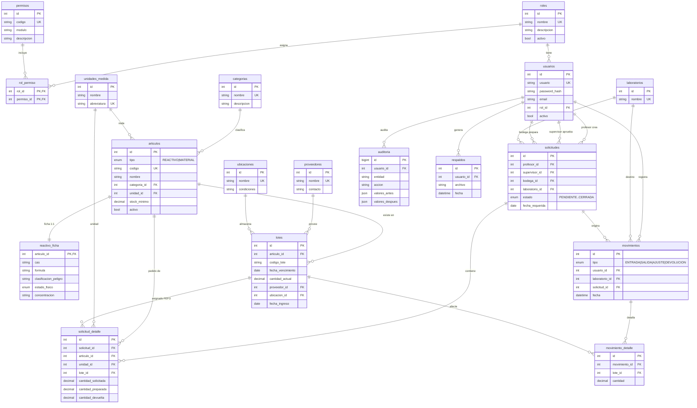

# Diagrama Entidad-Relación — LabQuim

Modelo relacional del sistema de inventario de reactivos y materiales de
laboratorio de química (18 tablas, MySQL 8). Corresponde a `01_schema.sql`.

## Notas de lectura

- **Existencia solo en `lotes`.** `articulos` es el maestro; la cantidad real
  vive repartida en sus lotes. Total de un artículo = suma de `cantidad_actual`
  de sus lotes activos. Índice `(articulo_id, fecha_vencimiento)` soporta **FEFO**.
- **`reactivo_ficha` es 1:1 con `articulos`** y solo aplica a reactivos (CAS,
  fórmula, peligro GHS, estado físico).
- **`solicitudes` referencia a `usuarios` tres veces**: profesor (crea),
  supervisor (aprueba) y bodega (prepara/entrega).
- **`movimientos` ↔ `movimiento_detalle`** es el maestro-detalle de inventario;
  cada línea afecta un `lote`. Una SALIDA por FEFO puede tener varias líneas
  (varios lotes) para una sola línea de solicitud.
- **`solicitud_detalle.lote_id`** se asigna al preparar (FEFO); `cantidad_devuelta`
  solo se usa en materiales/cristalería (préstamo con devolución).
